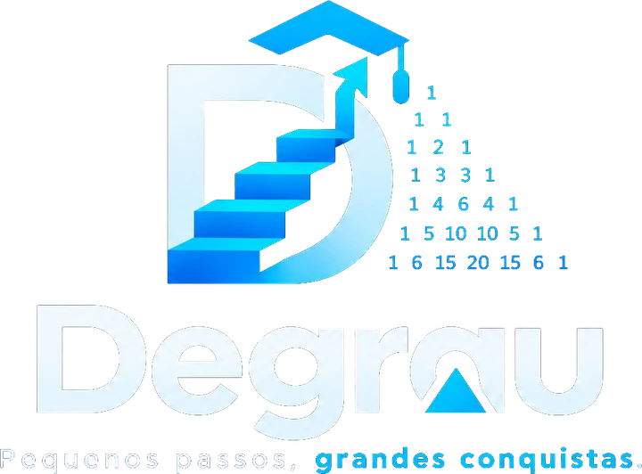
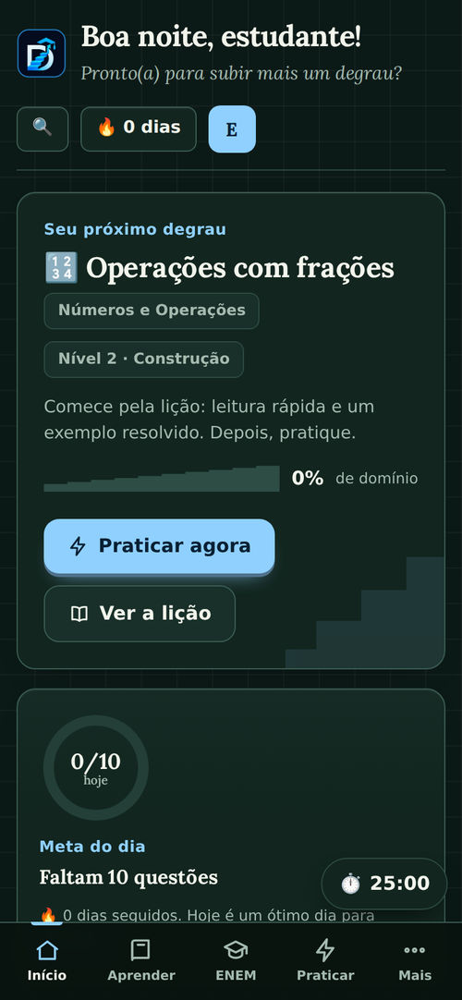
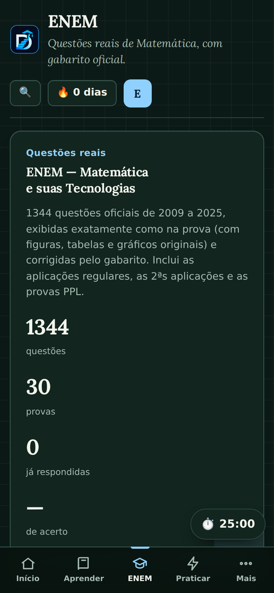
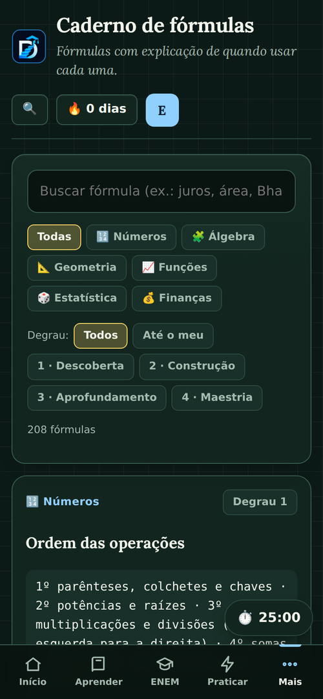
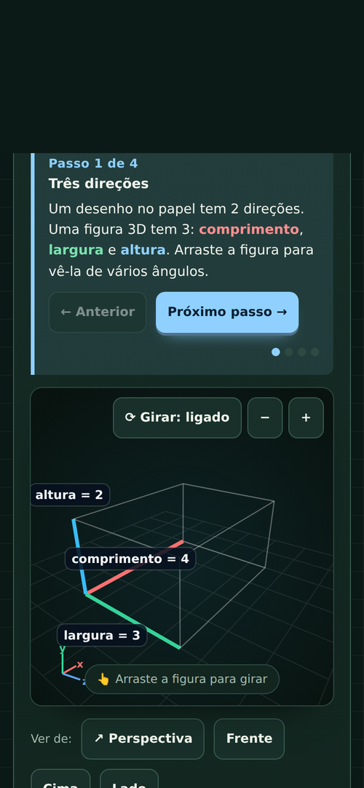
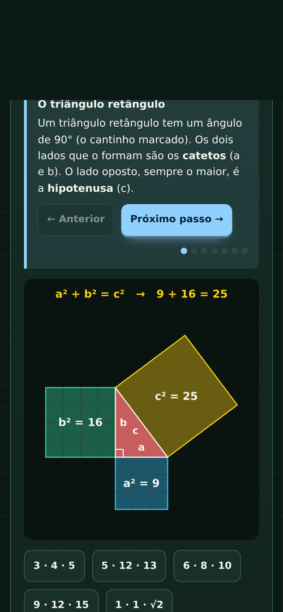
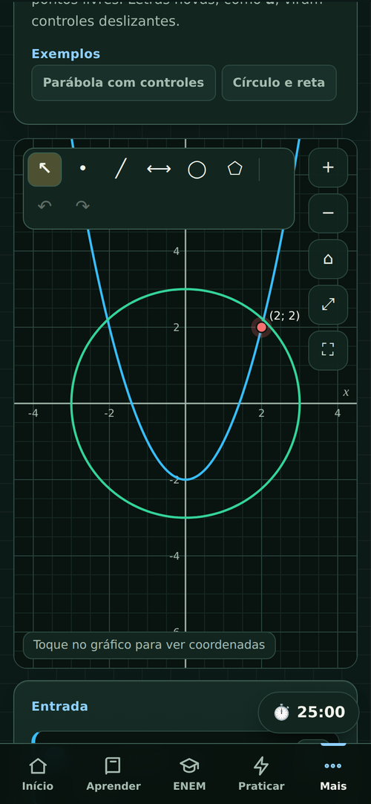

<div align="center">



# Matemática, um degrau de cada vez.

**Trilhas por nível, questões reais do ENEM, fórmulas explicadas, demonstrações em 3D e gráficos interativos.**
Tudo roda no navegador: sem cadastro, sem servidor, sem rastreamento.

[](https://Arabiano0301.github.io/degrau/)


</div>

---

## ✨ O que tem dentro

| | |
|---|---|
| 🪜 **Trilhas em 4 níveis** | 6 áreas da Matemática, do 6º ano ao 3º ano, com lição curta e questões que mudam a cada vez. |
| 🎓 **ENEM** | **1344 questões oficiais** de 2009 a 2025 (30 provas), exibidas como na prova e corrigidas pelo gabarito. |
| 📒 **Caderno de fórmulas** | **208 fórmulas** com explicação de *quando usar* cada uma, busca e filtro por nível. |
| 🧊 **Demonstrações em 3D** | Cubo, prisma, cilindro, pirâmide e cone: volume e área total passo a passo, com planificação e quiz. |
| 🎬 **Outras demonstrações** | Pitágoras, seno e cosseno, área do círculo, PA e PG, probabilidade, sólidos de Platão e cônicas. |
| 📈 **Gráficos estilo GeoGebra** | Funções, pontos, retas, controles deslizantes, tangente, derivada, integral e extremos. |
| 🏆 **Motivação** | XP, níveis, sequência de dias, meta diária, caderno de erros, ranking e olimpíadas. |

## 📱 Telas

<div align="center">



<br>



</div>

## 🚀 Como usar

**Online:** abra o link do botão **Abrir o app** acima (GitHub Pages).

**No seu computador:** baixe o repositório e dê dois cliques em `index.html`. Não precisa instalar nada.

**No celular:** abra o link no Chrome ou Safari e use *Adicionar à tela inicial* para ter um atalho.

## 🔒 Privacidade e segurança

- O progresso fica **só no seu aparelho** (`localStorage`). Nada é enviado para lugar nenhum.
- O código não faz requisições de rede e não carrega scripts, fontes ou imagens externas.
- O `index.html` traz uma **Content-Security-Policy** que bloqueia conexões externas, como defesa extra.
- Para apagar seus dados, limpe os dados do site no navegador.

## 🧱 Tecnologia

Um único arquivo `index.html` em **HTML + CSS + JavaScript puro**, sem frameworks e sem etapa de build.
O 3D e os gráficos usam um motor próprio sobre `<canvas>`, sem bibliotecas.

```
degrau/
├── index.html        # o aplicativo inteiro
├── docs/img/         # logo e capturas de tela
├── LICENSE           # MIT (código)
├── SECURITY.md
└── README.md
```

> **Aviso de desempenho:** o `index.html` tem cerca de 36 MB porque inclui as imagens das questões do ENEM.
> A primeira abertura pode levar alguns segundos; depois o navegador guarda em cache.

## 📚 Fontes, créditos e direitos autorais

- As questões e os gabaritos são das provas do **ENEM**, divulgadas pelo **INEP/MEC**.
- Alguns textos de apoio e imagens das provas pertencem aos seus autores e fontes originais.
  Eles são reproduzidos aqui para **fins educacionais, sem fins lucrativos**, com indicação da fonte.
- Se você é titular de direitos e quer a remoção de algum conteúdo, abra uma *issue* e ele será retirado.
- A licença MIT abaixo vale para o **código**, não para o conteúdo das provas.

## 🤝 Contribuindo

Achou um erro numa questão, fórmula ou explicação? Abra uma [issue](../../issues) com o print e o local.
Sugestões de novas demonstrações são bem-vindas.

## 📄 Licença

[MIT](LICENSE) © 2026 Arabiano0301
